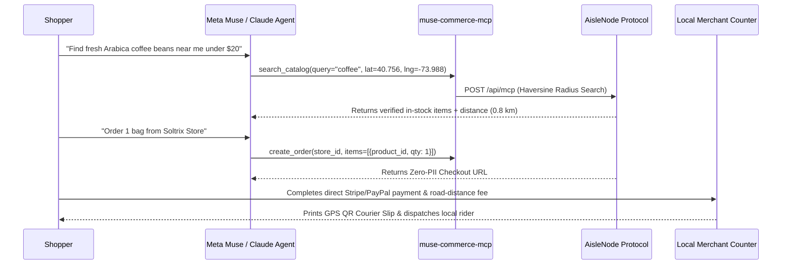

# muse-commerce-mcp

**Open-source Model Context Protocol (MCP) bridge connecting Meta Muse, Llama, and Anthropic Claude agents to live neighborhood retail store shelves.**

[](https://aislenode.soltrixstudios.com)
[](https://registry.modelcontextprotocol.io/?q=muse-commerce-mcp)
[](https://glama.ai/mcp/servers/marvo-bd/muse-commerce-mcp)
[](https://m8ven.ai/mcp/marvo-bd-muse-commerce-mcp-ctncci?s=readme)
[](./LICENSE)

---

## Why This Exists

Autonomous AI shopping agents (**Meta Muse**, **Claude**, **Llama**) can search global e-commerce giants, but neighborhood brick-and-mortar shops remain invisible to them. Traditional local stores cannot afford expensive POS integrations or give up 30% commissions to delivery marketplaces.

**`muse-commerce-mcp`** bridges conversational AI agents directly to verified local retail inventories via the [AisleNode Protocol](https://aislenode.soltrixstudios.com):

- **Real-Time Geofenced Discovery**: Query in-stock products across physically audited neighborhood stores using Haversine GPS radius filtering.
- **Zero-PII Agent Reservation**: Agents reserve items and generate a secure checkout handoff link without handling sensitive shopper credit cards or home addresses inside the LLM context.
- **100% Non-Custodial Direct Settlement**: Shoppers pay the merchant directly via Stripe or PayPal. The protocol never touches or pools merchant revenue.
- **Instant Counter & Courier Dispatch**: Orders chime live on the merchant's counter web terminal and generate a thermal dispatch slip with an embedded Google Maps GPS QR code for local bike couriers.

---

## Architecture



---

## Quick Start

### 1. Configure for Meta Muse / Claude Desktop

Add `muse-commerce-mcp` to your agent configuration file (`claude_desktop_config.json` or Meta Muse MCP config):

```json
{
  "mcpServers": {
    "muse-commerce": {
      "command": "npx",
      "args": ["-y", "muse-commerce-mcp"]
    }
  }
}
```

### 2. Streamable HTTP Endpoint (Official MCP Registry & Remote Agents)

Connect directly to the hosted Streamable HTTP MCP server (`io.github.marvo-bd/muse-commerce-mcp`):

- **Streamable HTTP / JSON-RPC Endpoint**: `https://aislenode.soltrixstudios.com/api/mcp`
- **Method**: `POST`

#### Example: Search Local Inventory by GPS Radius

```bash
curl -X POST https://aislenode.soltrixstudios.com/api/mcp \
  -H "Content-Type: application/json" \
  -d '{
    "action": "search_catalog",
    "params": {
      "query": "coffee",
      "customer_lat": 40.756076,
      "customer_lng": -73.988407,
      "max_distance_km": 15
    }
  }'
```

---

## Available MCP Tools

| Tool Name | Description | Required Inputs |
| :--- | :--- | :--- |
| **`search_catalog`** | Search live in-stock products across verified physical stores sorted by distance. | `query` (`customer_lat`, `customer_lng`, `max_distance_km` optional) |
| **`create_order`** | Reserve stock and generate a direct merchant checkout URL. Zero shopper PII required from the LLM. | `store_id`, `items` (`[{ product_id, qty }]`) |
| **`check_order_status`** | Poll real-time order payment, packing, and courier dispatch status. | `order_id` |
| **`report_store`** | Autonomous trust & safety reporting for phantom stock, deceptive pricing, or bad coordinates. | `store_id`, `category`, `details` |

---

## Example Agent Prompts

Once connected, test your agent with natural language queries:

- *"Search local stores within 10km of latitude 40.756, longitude -73.988 for Arabica coffee beans."*
- *"Create an order for 1 bag of Arabica Coffee Beans from that store and give me the checkout link."*
- *"Check the fulfillment status of order `[order_id]`."*

---

## Onboard a Physical Retail Store

Are you a merchant or testing a full end-to-end physical counter workflow?

1. Visit **[aislenode.soltrixstudios.com](https://aislenode.soltrixstudios.com)**
2. Sign in with Google, pin your physical storefront GPS coordinates, and upload your CSV catalog.
3. Once verified, your shelves are immediately discoverable by every agent running `muse-commerce-mcp`.

---

## License

MIT License. Built and maintained by [Soltrix Studios](https://aislenode.soltrixstudios.com).
